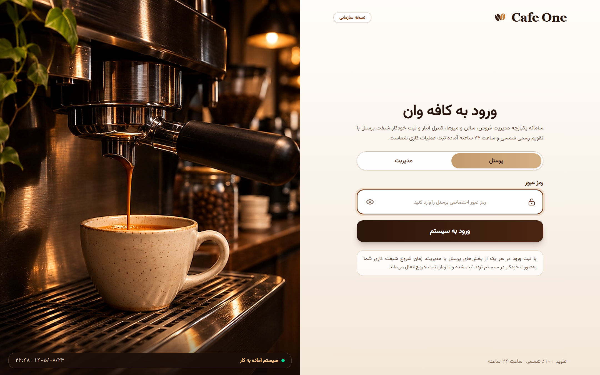
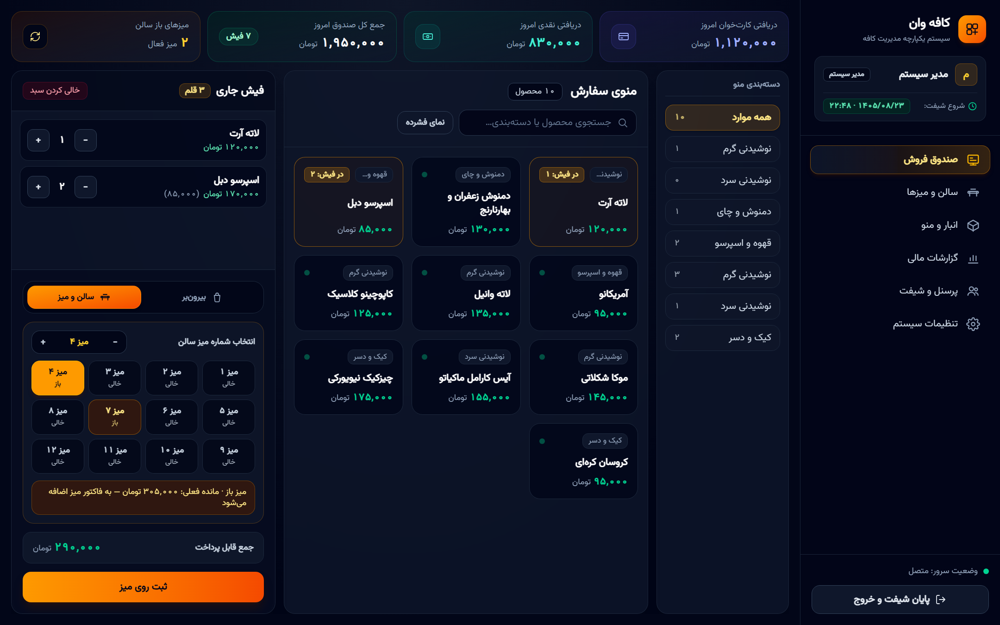
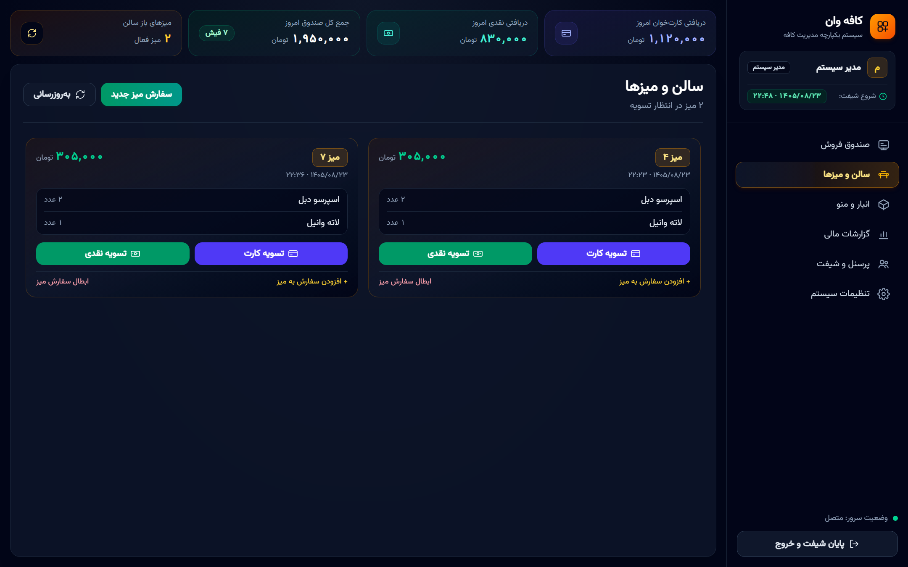
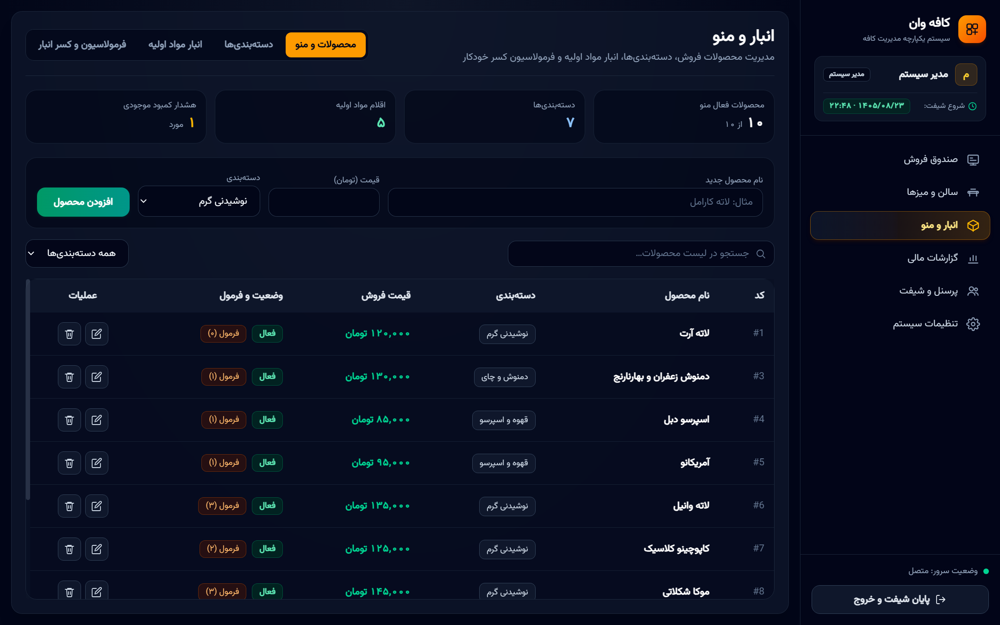
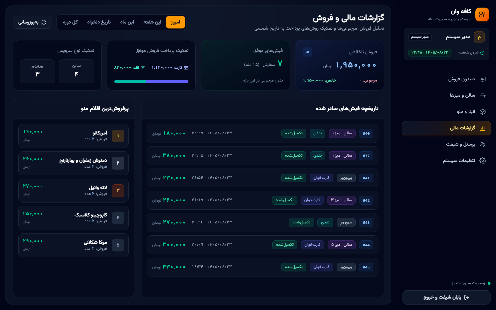
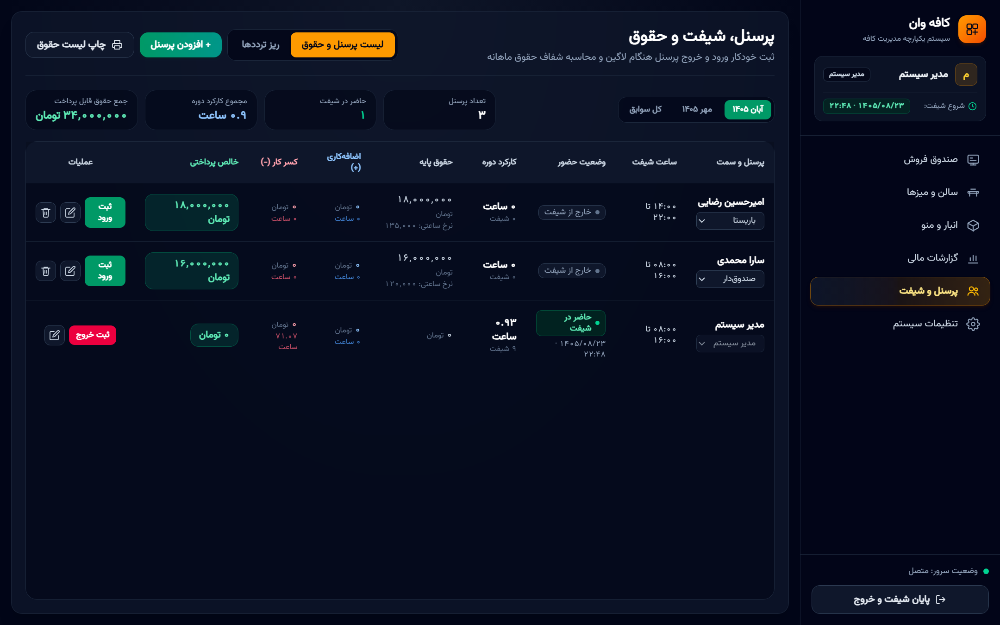
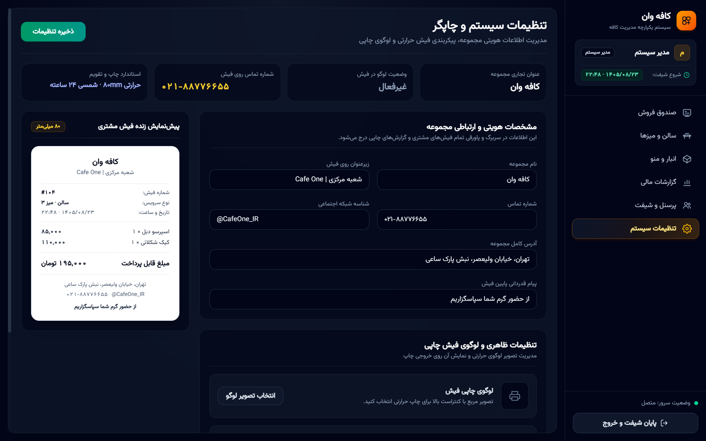
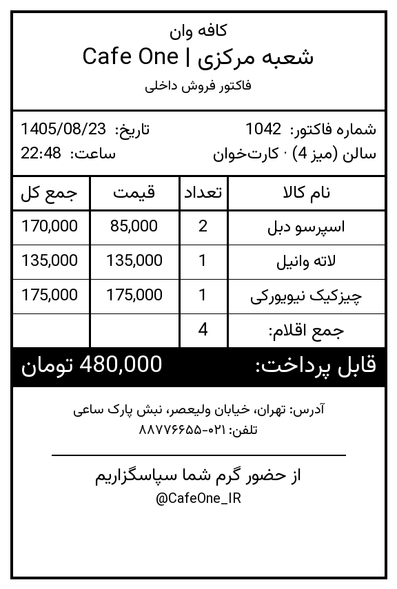

<div dir="rtl">

# کافه وان (Cafe One)

**سامانه جامع و دسکتاپ مدیریت کافه، رستوران و صندوق فروش (POS)** با رابط کاربری کاملاً فارسی، **تقویم ۱۰۰٪ رسمی شمسی**، **ساعت ۲۴ ساعته**، مدیریت هوشمند انبار و فرمولاسیون (Recipe)، کنترل خودکار شیفت و حقوق پرسنل، و پشتیبانی از فیش‌پرینتر حرارتی ۸۰ میلی‌متری ویندوز.

<p align="center">
  
  
  
  
  
</p>

---

## معرفی پروژه

**Cafe One** یک نرم‌افزار صندوق فروش (POS) و مدیریت یکپارچه مجموعه برای کافه‌ها است که بدون نیاز به اینترنت و به‌صورت محلی (Offline-First) با هسته **FastAPI + SQLite (حالت WAL)** و پوسته دسکتاپ **PyWebView** روی ویندوز اجرا می‌شود. تمامی تاریخ‌ها، گزارش‌ها، نمودارها و فیش‌های چاپی با تقویم رسمی هجری شمسی (`jdatetime`) و فرمت استاندارد ۲۴ ساعته محاسبه و نمایش داده می‌شوند.

---

## تصاویر محیط برنامه

### ۱. صفحه ورود سازمانی (تفکیک تب پرسنل و مدیریت)
> ورود هر کاربر به‌صورت خودکار شروع شیفت کاری او را ثبت می‌کند. دسترسی تب **پرسنل** و تب **مدیریت** در سطح بک‌اند تفکیک شده است و صفحه بدون اسکرول در اندازه دسکتاپ جای می‌گیرد.



### ۲. صندوق فروش (POS)
> انتخاب سریع دسته‌بندی‌ها، جستجوی هم‌زمان بر اساس نام محصول و دسته‌بندی، نمای کارتی یا فشرده برای منوهای شلوغ، نشانگر تعداد در سبد (`در فیش: X`)، حالت بیرون‌بر یا سالن (انتخابگر میز ۱۲تایی)، و نوار لحظه‌ای وضعیت فروش و نقدینگی صندوق در بالای صفحه.



### ۳. مدیریت سالن و میزها
> مشاهده لحظه‌ای میزهای باز، افزودن سفارش جدید به فاکتور باز میز، تسویه کارتخوان یا نقدی با ثبت زمان تسویه، و ابطال سفارش میز با بازگشت خودکار موجودی انبار.



### ۴. انبار، منو و فرمولاسیون (Recipe)
> مدیریت محصولات و دسته‌بندی‌ها، تعریف مواد اولیه، اتصال هر محصول به مواد اولیه مصرفی (کسر خودکار انبار هنگام فروش)، ثبت ورود بار، ضایعات و انبارگردانی و نگهداری لاگ کامل گردش کالا.



### ۵. گزارشات مالی و تحلیلی
> فیلتر گزارش‌ها بر اساس **امروز، این هفته، این ماه، تاریخ دلخواه شمسی** و **کل دوره**، نمایش فروش ناخالص و خالص، تفکیک کارتخوان و نقد، نسبت سالن به بیرون‌بر، رتبه‌بندی پرفروش‌ترین اقلام، امکان چاپ مجدد فیش و ثبت مرجوعی کامل.



### ۶. پرسنل، حضور و غیاب و محاسبه حقوق
> ثبت ورود و خروج خودکار هنگام لاگین و لاگ‌اوت، ثبت دستی ورود/خروج، پشتیبانی از مرخصی، و محاسبه خودکار کارکرد دوره، اضافه‌کاری و کسر کار بر اساس ساعت موظفی هر کارمند و حقوق پایه / نرخ ساعتی.



### ۷. تنظیمات سیستم، چاپگر حرارتی و پیش‌نمایش زنده فیش
> ویرایش مشخصات مجموعه، آپلود لوگوی چاپی، انتخاب نحوه خروجی فیش (**پیش‌نمایش روی صفحه / ارسال مستقیم به فیش‌پرینتر ویندوز / هر دو / بدون چاپ خودکار**)، تعیین نام پرینتر ویندوز، **تست چاپ فیش آزمایشی** و مشاهده پیش‌نمایش زنده فیش ۸۰ میلی‌متری.



### ۸. نمونه خروجی فیش حرارتی ۸۰ میلی‌متری فارسی
> رندر دقیق و خوانای فیش مشتری با عرض ۵۷۶ پیکسل (`80mm`)، پشتیبانی کامل از حروف و اعداد فارسی، تاریخ شمسی، تفکیک سالن/بیرون‌بر، جدول اقلام و مبلغ قابل پرداخت.

<p align="center">
  
</p>

---

## ویژگی‌ها و استانداردهای فنی

| حوزه | قابلیت‌های پیاده‌سازی‌شده |
| :--- | :--- |
| **امنیت و نشست‌ها** | هش ایمن رمز عبور (`scrypt` + مقایسه مقاوم در برابر زمان‌بندی)، توکن نشست `Bearer` با انقضای ۲۴ ساعته، و تفکیک نقش `ADMIN` از پرسنل (`CASHIER`, `BARISTA`, `WAITER`) در میان‌افزار و ورود |
| **پایداری ثبت سفارش** | کلید یکتا (`OrderSubmission` Idempotency Key) برای جلوگیری از ثبت تکراری در قطع و وصل شبکه و قفل تراکنشی انبار (`OrderInventory`) |
| **عملکرد در دیتای حجیم** | فعال‌سازی SQLite `WAL Mode` (`journal_mode=WAL`, `busy_timeout=5000`)، ۶ ایندکس اختصاصی روی جدول‌های `Order`, `OrderItem` و `Attendance`، صفحه‌بندی API (`limit`) و رندر تدریجی در رابط کاربری |
| **مقیاس‌پذیری منو** | نمای فشرده/کارتی، جستجوی هم‌زمان نام کالا و دسته‌بندی، نمایش اولیه ۸۰ آیتم با دکمه توسعه کامل منو |
| **چاپگر حرارتی ویندوز** | چاپ مستقیم با `.NET PrintDocument` در عرض `80mm` روی پرینتر پیش‌فرض یا پرینتر نام‌گذاری‌شده ویندوز با مسیر نسبی قابل انتقال برای لوگو و فونت |
| **تقویم ۱۰۰٪ شمسی** | پیاده‌سازی بومی تقویم جلالی در فرانت‌اند (`frontend/app/calendar.ts`) و بک‌اند (`jdatetime` روی منطقه زمانی `Asia/Tehran`) بدون هیچ متن میلادی یا AM/PM |

---

## ساختار پروژه

```text
Cafe One/
├── main.py                      # راه‌انداز دسکتاپ PyWebView و سرو فایل‌های استاتیک FastAPI روی پورت 8080
├── requirements.txt             # وابستگی‌های پایتون پروژه
├── setup_target_pc.bat          # اسکریپت نصب خودکار روی سیستم مقصد (venv، پکیج‌ها و Prisma)
├── start_cafe_one.bat           # اجرای سریع نسخه دسکتاپ بدون نیاز به Node.js در سیستم مقصد
├── backend/
│   ├── api.py                   # تمام Routeها، میدلور احراز هویت، تراکنش‌های سفارش/انبار و بهینه‌سازی WAL
│   ├── credentials.py           # مدیریت هش رمزها، کلید سشن و مسیر دیتابیس
│   ├── printer.py               # تولید تصویر فیش ۸۰ میلی‌متری فارسی و ارسال مستقیم به پرینتر ویندوز
│   ├── pos_smoke.py             # تست یکپارچه اندپوینت‌ها روی کپی موقت دیتابیس
│   ├── perf_smoke.py            # تست فشار و بنچمارک (۳٬۰۰۰ سفارش، ۶٬۰۰۰ قلم، ۱۲۰ محصول، ۱٬۰۰۰ تردد)
│   └── prisma/
│       └── schema.prisma        # مدل‌های Employee, Attendance, Leave, Category, Product, RawMaterial, Recipe, Order, ...
├── frontend/
│   ├── app/
│   │   ├── page.tsx             # رابط کاربری کامل صندوق، میزها، انبار، گزارشات، پرسنل و تنظیمات
│   │   ├── calendar.ts          # توابع تقویم هجری شمسی و قالب‌بندی ۲۴ ساعته تاریخ/ساعت
│   │   ├── globals.css          # استایل‌های تم شرکتی تیره/گرم و چاپ
│   │   └── layout.tsx           # ریشه اپلیکیشن و فونت وزیرمتن
│   └── next.config.ts           # پشتیبانی از خروجی استاتیک (CAFE_ONE_DESKTOP_BUILD=1)
└── docs/
    └── screenshots/             # تصاویر واقعی بخش‌های مختلف سیستم
```

---

## نصب و راه‌اندازی

### ۱. نصب سریع روی ویندوز (سیستم مقصد)

اگر قصد اجرای برنامه روی کامپیوتر صندوق یا سیستم جدید را دارید، پایتون ۳.۱۱ تا ۳.۱۴ را نصب کنید و اسکریپت آماده را اجرا کنید (در صورت وجود پوشه بیلدشده `frontend/out`، نیازی به نصب Node.js روی سیستم مقصد نیست):

```bat
setup_target_pc.bat
```

سپس هر زمان برای اجرای برنامه کافی است فایل زیر را باز کنید:

```bat
start_cafe_one.bat
```

> **نکته ورود اولیه:** در صورتی که جدول پرسنل خالی باشد، در اولین ورود با انتخاب تب **مدیریت** و رمز پیش‌فرض `123`، حساب مدیر سیستم به‌صورت خودکار ایجاد می‌شود. بلافاصله پس از اولین ورود از بخش **پرسنل و شیفت** رمز مدیر را تغییر دهید و برای صندوقدارها/باریستاها حساب مجزا بسازید.

---

### ۲. راه‌اندازی دستی / محیط توسعه (Development)

#### پیش‌نیازها
- **Python 3.11+** (آزمایش‌شده با Python 3.14)
- **Node.js 20+** (فقط در زمان توسعه یا گرفتن بیلد جدید از فرانت‌اند)

#### مراحل بک‌اند:
```powershell
python -m venv .venv
.\.venv\Scripts\Activate.ps1
pip install -r requirements.txt
prisma generate --schema=backend\prisma\schema.prisma
prisma db push --schema=backend\prisma\schema.prisma
```

#### مراحل بیلد استاتیک فرانت‌اند برای دسکتاپ:
```powershell
cd frontend
npm install
$env:CAFE_ONE_DESKTOP_BUILD="1"
npx next build --webpack
cd ..
python main.py
```

#### اجرای حالت توسعه فرانت‌اند (Dev Server):
در یک ترمینال بک‌اند را اجرا کنید:
```powershell
uvicorn backend.api:app --reload --port 8080
```
و در ترمینال دوم فرانت‌اند را اجرا کنید:
```powershell
cd frontend
npm run dev
```

---

## اجرای تست‌ها و بنچمارک

تمامی تست‌ها روی یک **کپی موقت** از پایگاه‌داده اجرا می‌شوند و به اطلاعات اصلی کافه آسیبی نمی‌رسانند:

```powershell
# تست یکپارچه عملکرد صندوق، انبار، مرجوعی، شیفت و دسترسی‌ها (۸ سناریوی کامل)
python -m backend.pos_smoke

# تست فشار با ۳٬۰۰۰ سفارش، ۶٬۰۰۰ ردیف کالا، ۱۲۰ محصول و ۱٬۰۰۰ رکورد تردد + تفکیک loginMode
python -m backend.perf_smoke
```

بررسی کیفیت کد و بیلد فرانت‌اند:
```powershell
cd frontend
npx tsc --noEmit
npm run lint
```

</div>
